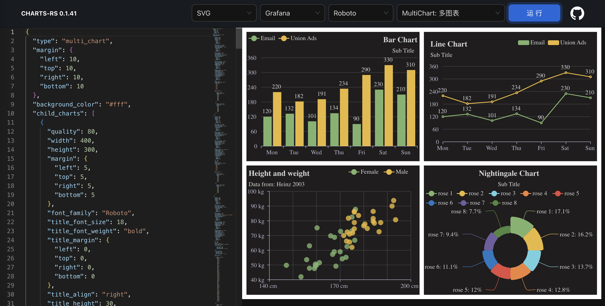

# charts-rs-web

基于 [charts-rs](https://github.com/vicanso/charts-rs) 的图表与 Mermaid 渲染服务（内置 Web Playground 与 MCP Server），支持以 JSON 或 Mermaid DSL 定义图表，返回 SVG、PNG、JPEG、WebP 或 AVIF 格式。

<p align="center">
  
</p>

## HTTP接口

- `GET /api/basic-info`: 返回应用信息：版本、字体、主题、已注册地图与支持图表类型。默认支持两种字体`Noto Sans SC`与`Roboto`
- `GET /api/examples`: 返回后端统一示例库（60 个图表变体 + 13 种 Mermaid 规范图示例）
- `GET /api/charts?opts=<json>&format=<svg|png|jpeg|webp|avif>`: 通过 URL 参数直接预览或分享图表（`format` 默认 `svg`）
- `POST /api/charts/png`: 生成Png图表
- `POST /api/charts/jpeg`: 生成Jpeg图表
- `POST /api/charts/webp`: 生成Webp图表
- `POST /api/charts/avif`: 生成Avif图表（注意生成avif需要时间较长）
- `POST /api/charts/svg`: 生成Svg图表

## MCP

服务在`/mcp`提供 [MCP](https://modelcontextprotocol.io) 接口（Streamable HTTP，无状态），LLM可通过它生成 30 类图表与 13 种 Mermaid 图表，包含 6 个工具与 `charts://` 资源：

- `list_chart_types`: 返回所有图表类型目录、选图/变体指南、可用主题、已加载字体（含 CJK 提示）、已注册 GeoJSON 地图、Mermaid 能力及 `RenderLimits`
- `get_chart_schema`: 返回指定图表类型的 Draft 2020-12 JSON Schema（`essential`/`full`）、实时主题/字体/地图枚举及验证过的示例（`mermaid` 会附带全部 13 种图示例及已知限制）
- `validate_chart`: 按 Schema、`RenderLimits` 与 Mermaid 语法预校验 JSON 参数，一次返回最多 50 条结构化 `ValidationIssue` 及非阻塞字体/CJK 提示
- `render_chart`: 预校验并渲染图表（`format` 可选 `png`（默认）、`jpeg`、`webp`、`svg`），`mermaid` 默认 `allow_links: false`
- `validate_mermaid`: 直接校验 Mermaid 源码语法与语义（带 1-based 行号与修正建议）
- `render_mermaid`: 直接从 Mermaid 源码渲染图表（`allow_links` 默认 `false`）
- **Resources**: `charts://themes`、`charts://fonts`、`charts://maps`、`charts://mermaid/capabilities`、`charts://examples/{type}`、`charts://examples/mermaid/{diagram}`（即使客户端不读取 Resources，`list_chart_types` 与 `get_chart_schema` 也会在工具响应中内嵌完整运行时信息）

客户端配置地址为`http://127.0.0.1:5000/mcp`即可，以 Claude Code 为例：

```bash
claude mcp add --transport http charts http://127.0.0.1:5000/mcp
```

默认不校验请求的`Host`。如果需要限制，可通过ENV指定`MCP_ALLOWEDHOSTS`（多个以,分隔），如`MCP_ALLOWEDHOSTS=charts.example.com`，不在列表中的`Host`返回403。

## JSON参数

生成PNG与SVG的json参数基本一致，下面针对各参数一下讲解。各图表的完整参数（含专属参数与示例）可参考 charts-rs 的 [JSON 参数文档](https://github.com/vicanso/charts-rs/blob/main/docs/json-zh.md)。

需要注意，参数在使用前会先校验：未知的键、类型不对的值或未知的枚举值都会返回出错，而不是被忽略。

### 公共参数

- `type`: 图表类型，默认为`bar`，可选的值见[图表类型](#图表类型)
- `quality`: 输出的 PNG 质量，默认为`80`，范围`0`–`100`。`0`表示不减色，沿用渲染器的快速压缩。`1`–`100`用 NeuQuant 减色后再做 deflate：数值越大，调色板颜色越多（64–256），deflate 等级也越高（1–9）。默认`80`约为 217 色、deflate 7
- `compact`: 是否压缩 SVG，JSON API 默认为`false`（Web Playground 开关默认启用 `true`）。为`true`时去掉空白、路径改为相对坐标、合并网格线并缩短属性。画面不变，体积通常小 20–30%。`png`、`jpeg`、`webp`、`avif` 会先压缩 SVG 再栅格化，位图体积不变
- `theme`: 图表主题，支持`light`，`dark`，`ant`，`vintage`，`shine`，`walden`，`westeros`，`chalk`，`grafana`以及`shadcn`共10种主题色
- `width`: 图表宽度，默认为600
- `height`: 图表高度，默认为400
- `background_color`: 图表底色，不同的主题有不同的默认颜色
- `margin`: 图表的margin，默认为`{"left":5,"top":5,"right":5,"bottom":5}`
- `font_family`: 图表使用的字体，默认为`Roboto`。未注册的字体名称不会报错而是静默回退到 `Roboto` 测量文字宽度；包含中文等 CJK 字符时，请显式指定已加载的中文字体（如 `Noto Sans SC`）
- `title_text`: 图表标题
- `title_font_size`: 标题的字体大小，默认为`18`
- `title_font_color`: 标题的字体颜色，不同的主题有不同的默认颜色
- `title_font_weight`: 标题的字体粗细，默认为`bold`
- `title_margin`: 标题的margin，默认为`0`
- `title_align`: 标题的位置，默认为`center`，可选值为：`left`, `center`以及`right`
- `title_height`: 标题高度，默认为`30`
- `sub_title_text`: 子标题
- `sub_title_font_size`: 子标题的字体大小，默认为`14`
- `sub_title_font_color`: 子标题的字体颜色，不同的主题有不同的默认颜色
- `sub_title_font_weight`: 标题的字体粗细，默认为空
- `sub_title_margin`: 子标题的margin，默认为`0`
- `sub_title_align`: 子标题的位置，默认为`center`，可选值为：`left`, `center`以及`right`
- `sub_title_height`: 子标题高度，默认为`20`
- `legend_font_size`: 图示的字体大小，默认为`14`
- `legend_font_color`: 图示的字体颜色，不同的主题有不同的默认颜色
- `legend_font_weight`: 图标的字体粗细，默认为空
- `legend_align`: 图示的位置，默认为`center`，可选值为：`left`, `center`以及`right`
- `legend_margin`: 图示的margin，默认为`0`
- `legend_category`: 图示的类型，默认为`normal`，可选值为：`normal`以及`rect`
- `legend_show`: 图示是否显示，默认为`true`
- `texts`: 叠加在图表上的文字（数据来源、版权信息、水印等），类型为数组，通过`left`、`top`、`right`、`bottom`指定与边缘的距离，`reserve`为`true`时为其预留空间而不是覆盖在图表上

### 图表类型

`type`可选的值如下；未指定或为空时默认为`bar`，未知的`type`会返回参数错误（兼容旧别名 `multi_chart` → `multi`、`guage` → `gauge`）：

| type | 图表 |
| --- | --- |
| `bar` | 柱状图（默认），可堆叠（`stack_percent`为百分比堆叠）、与折线混合或添加误差线（`error_bar`） |
| `horizontal_bar` | 水平柱状图 |
| `line` | 折线图，支持平滑、阶梯线（`step`）、填充、区间带（`band`）以及数值/时间X轴（`x_axis_values`）；`mark_points` 可按 `index` 标记任意点 |
| `pie` | 饼图、南丁格尔玫瑰图，支持半环（`end_angle`）与嵌套多环（`ring`） |
| `radar` | 雷达图，`shape`为`circle`时网格为同心圆，`indicators.min`为各轴圆心值 |
| `scatter` | 散点图，`bubble`为`true`时为气泡图，`regression`可添加回归线，`contour`为密度等高线，`marginal`为边缘直方图 |
| `candlestick` | 蜡烛图，`candlestick_style`为`ohlc`时为OHLC图 |
| `table` | 表格，单元格为数字数组时显示为迷你图（sparkline） |
| `heatmap` | 热力图，支持多色与分段配色，`symbol`为`circle`时为打卡图 |
| `funnel` | 漏斗图 |
| `waterfall` | 瀑布图 |
| `calendar` | 日历图 |
| `gauge` | 仪表盘，支持分段着色（`thresholds`）与多环进度（`multi_ring`），兼容旧拼写`guage` |
| `treemap` | 矩形树图 |
| `box_plot` | 箱线图 |
| `sunburst` | 旭日图 |
| `sankey` | 桑基图，`orient`为`vertical`时为纵向 |
| `tree` | 树图，支持四个方向以及径向布局（`layout`） |
| `graph` | 关系图 |
| `parallel` | 平行坐标图 |
| `theme_river` | 主题河流图 |
| `histogram` | 直方图 |
| `polar_bar` | 极坐标柱状图 |
| `chord` | 和弦图 |
| `gantt` | 甘特图 |
| `map` | 地图（区域着色），可通过`geo_json`传入GeoJSON对象或预注册地图名（内置`demo`，或通过`CHARTS_MAP_PATH`加载） |
| `lines` | 流向图，点与点之间的流向线，传入`geo_json`对象或地图名时绘制在地图上 |
| `bullet` | 子弹图，每行一个指标与其目标值对比 |
| `mermaid` | Mermaid 图表，通过 `source` 传入源码，支持 flowchart/sequence/state/class/er/mindmap/quadrant/pie/gantt/sankey/xychart/radar/treemap 共 13 类图 |
| `multi` | 多图表拼合（兼容旧别名 `multi_chart`），见[多图的相关属性](#多图的相关属性) |

### 网格属性

使用网格的图表中使用，如：`line`，`bar`等

- `grid_stroke_color`: 图表网格线条颜色，不同的主题有不同的默认颜色
- `grid_stroke_width`: 图表网格线条宽度，默认为`1`


### 图表线条相关属性

- `series_stroke_width`: 图表线条宽度，默认为`2`
- `series_label_font_color`: 图表中的label字体颜色，不同的主题有不同的默认颜色
- `series_label_font_size`: 图表中的label字体大小，默认为`14`
- `series_label_font_weight`: 图表中label字体粗细，默认为空
- `series_colors`: 图表使用的颜色列表，不同的主题有不同的颜色列表，用于不同各类的示例中使用
- `series_smooth`: 图表线条是否使用平滑曲线，默认为`false`
- `series_fill`: 图表线条曲线是否填充对应区域，默认为`false`


### X轴相关属性

- `x_axis_data`: X轴的数据
- `x_axis_height`: X轴的高度，默认为`30`
- `x_axis_stroke_color`: X轴线条的颜色，不同的主题有不同的默认颜色
- `x_axis_font_size`: X轴的字体大小，默认为`14`
- `x_axis_font_color`: X轴的字体颜色，不同的主题有不同的默认颜色
- `x_axis_font_weight`: X轴的字体粗细，默认为空
- `x_axis_name_gap`: X轴文本名称与轴的间隔，默认为`5`
- `x_axis_name_rotate`: X轴文本名称的旋转角度，默认为`0`
- `x_axis_margin`: X轴的margin，默认为None
- `x_boundary_gap`: X轴的坐标留边处理，无默认值，可设置为`true`或者`false`


### Y轴相关属性

- `y_axis_configs`: Y轴属性配置，类型为数组
- `y_axis_configs.axis_font_size`: Y轴字体大小，默认为`14`
- `y_axis_configs.axis_font_color`: Y轴字体颜色，不同的主题有不同的默认颜色
- `y_axis_configs.axis_stroke_color`: Y轴线条颜色，不同的主题有不同的默认颜色
- `y_axis_configs.axis_width`: Y轴宽度，未设置则通过计算得出
- `y_axis_configs.axis_split_number`: Y轴坐标分块数量，默认为`6`
- `y_axis_configs.axis_name_gap`: Y轴名称文本与轴的间隔，默认为`8`
- `y_axis_configs.axis_margin`: Y轴的margin，默认为None
- `y_axis_configs.axis_formatter`: Y轴名称格式化方式，可以使用以下方式`{c} ml`
- `y_axis_configs.axis_min`: Y轴的最少值，默认为None
- `y_axis_configs.axis_max`: Y轴的最大值，默认为None

### 图表数据列表

- `series_list`: 图表数据系列，类型为数组
- `series_list.name`: 数据名称，不能为空
- `series_list.index`: 指定数据的index，此index影响其颜色等，一般场景不需要指定
- `series_list.y_axis_index`: 数据对应的Y轴，如果该数据非使用第一个Y轴时可指定（同时Y轴需要初始化为多个）
- `series_list.label_show`: 数据的label是否展示，默认为`false`
- `series_list.category`: 数据的类型，用于在`bar`图表中指定某些数据以`line`的形式混合展示，可选值为`bar`与`line`
- `series_list.mark_points`: 标记系列中的点，`category`为`min`、`max`或`index`（配合`index`指定下标）

### 饼图相关属性

饼图有部分属性是其单独例如的，具体如下：

- `radius`: 半径，默认值为`150`
- `inner_radius`: 内半径，默认值为`40`
- `border_radius`: 圆角半径，默认为`8`
- `rose_type`: 是否玫瑰图形式，默认为`true`

### 蜡烛图相关属性

需要注意，K线图的数据合并在一维数组中，顺序为：开市值(open)，收市值(close)，最低值(lowest)，最高值(highest)

- `candlestick_up_color`: 上涨图颜色
- `candlestick_up_border_color`: 上涨图边框颜色
- `candlestick_down_color`: 下跌图颜色
- `candlestick_down_border_color`: 下跌图边框颜色

## 表格相关属性

表格的相关属性与其它图的不尽相同，与公共属性相同部分为：`type`，`quality`，`compact`，`theme`，`width`，`height`，`font_family`，`background_color`，还有`title`与`sub_title`部分也一致。

不相同的如下：

- `data`: 表格数据，其为二维数组，而且不能为空。第一个数组对应表头数据。单元格可以是字符串、数字或`null`，为数字数组时显示为迷你图
- `sparkline_type`: 迷你图的类型，可选值为`line`（默认）与`bar`
- `sparkline_color`: 迷你图的颜色，默认为主题的第一个颜色
- `spans`: 表格每列所占比例，例如[0.5, 0.2, 0.3]，默认为根据列的数量均分
- `text_aligns`: 表格列的文本对齐方式，默认为`left`，可以按需设置，如["left", "center", "right"]
- `border_color`: 表格边框颜色，不同的主题有不同的默认颜色
- `header_row_padding`: 表头的padding，默认为`{"left": 10, "top": 8, "right": 10, "bottom": 8}`
- `header_row_height`: 表头行高，默认为`30`
- `header_font_size`: 表头字体，默认`14`
- `header_font_color`: 表头字体颜色，不同的主题有不同的默认颜色
- `header_background_color`: 表头背景颜色，不同的主题有不同的默认颜色
- `body_row_padding`: 表头的padding，默认为`{"left": 10, "top": 5, "right": 10, "bottom": 5}`
- `body_row_height`: 表格内容行高，默认为`30`
- `body_font_size`: 表头字体，默认`14`
- `body_font_color`: 表头字体颜色，不同的主题有不同的默认颜色
- `body_background_colors`: 表头背景颜色，不同的主题有不同的默认颜色
- `cell_styles`: 定义表格中每一个格的相关属性，其为数组
- `cell_styles.font_color`: 表格中该格的字体颜色(可选)，若未指定则使用表格指定的字体颜色
- `cell_styles.font_weight`: 表格中该格的字体粗细(可选)
- `cell_styles.background_color`: 表格中该格的背景色(可选)，若未指定则使用表格指定的背景色
- `cell_styles.indexes`: 该表格中格的位置，数组为两位，第一位为行，第二位为列，表头为第一行，该参数不能为空


## Mermaid 相关属性

Mermaid 图表不使用 `series_list` 或 `x_axis_data`，支持以下字段：

- `source`: Mermaid 图表源码文本
- `theme`: 图表主题，默认`light`
- `width` / `height`: 目标宽高（像素）；省略时，图类引擎（`flowchart`、`sequenceDiagram`、`stateDiagram`、`classDiagram`、`erDiagram`、`mindmap`）会自动按内容计算尺寸
- `font_family`: 字体，默认`Roboto`（含中文时建议显式设为 `Noto Sans SC`）
- `background_color`、`margin`、`title_*`、`sub_title_*`、`texts`、`compact`: 与其它图表一致
- `allow_links`: 是否允许将 `click` / `link` 指令渲染为 SVG `<a href="...">`（仅放行 `http://`、`https://`、`mailto:` 与相对链接，阻止 `javascript:`/`data:`）。HTTP API 中默认 `true`；MCP 的 `render_mermaid` 与 `render_chart("mermaid")` 为安全起见默认 `false`（显式传 `true` 时开启）

支持 13 种规范图与 7 个别名：

- **规范图**：`flowchart`、`sequenceDiagram`、`stateDiagram-v2`、`classDiagram`、`erDiagram`、`mindmap`、`quadrantChart`、`pie`、`gantt`、`sankey-beta`、`xychart-beta`、`radar-beta`、`treemap-beta`
- **别名**：`graph`（→ `flowchart`）、`stateDiagram`（→ `stateDiagram-v2`）、`classDiagram-v2`（→ `classDiagram`）、`sankey`（→ `sankey-beta`）、`xychart`（→ `xychart-beta`）、`radar`（→ `radar-beta`）、`treemap`（→ `treemap-beta`）

最小 JSON 示例：

```json
{
  "type": "mermaid",
  "title_text": "Request Flow",
  "source": "flowchart LR\n  A[Client] --> B{Gateway}\n  B -->|OK| C[(Database)]"
}
```


## 多图的相关属性

- `margin`: 图表的margin，默认为`{"left":10,"top":10,"right":10,"bottom":10}`
- `background_color`: 背景色，默认无
- `child_charts`: 子图表列表
- `align_plots`: 是否对齐上下排列的子图表的绘图区（如K线图与其下方的成交量），默认为`false`

## 示例库与启动

内置示例与地图数据集中在 `examples/`（60 个图表变体 + 13 种 Mermaid 规范图示例）与 `maps/demo.json`（内置名为 `demo` 的示例地图），在编译期嵌入二进制并由 Web Playground（`GET /api/examples`）与 MCP 共享；`cargo test` 会自动对所有示例执行参数校验与 SVG 渲染验证。

需要注意，Docker 镜像加载了 `fonts/` 目录下的 `NotoSansSC` 字体（Regular / Light / Bold 3 个字体文件）。如果需要加载更多字体，可运行时挂载字体目录并通过环境变量 `CHARTS_FONT_PATH` 指定（多个目录以 `,` 分隔，容器内默认 `/usr/share/fonts`），支持 `ttf` 与 `otf`；字体加载到内存中，首次启动加载单个字体约需 100ms，加载越多启动越慢、内存占用越大。

常用环境变量如下：

| 变量 | 说明 | 默认值 |
| --- | --- | --- |
| `BASIC_LISTEN` | 服务监听地址 | `0.0.0.0:5000` |
| `CHARTS_FONT_PATH` | 字体目录列表（`,` 分隔，扫描 `.ttf` / `.otf`） | Docker 默认 `/usr/share/fonts` |
| `CHARTS_MAP_PATH` | GeoJSON 地图目录列表（`,` 分隔，扫描 `.json` / `.geojson`，按文件名注册供 `map`/`lines` 引用） | 空（仅内置 `demo`） |
| `CHARTS_THEME_<name>` | 注册自定义 JSON 主题（`<name>` 为主题名） | 无 |
| `CHARTS_THREADS` | Tokio 工作线程数 | CPU 核数 |
| `MCP_ALLOWEDHOSTS` | `/mcp` 允许的 `Host` 列表（`,` 分隔，不在列表中返回 403） | 空（不校验） |
| `LIMITS_MAXJSONBYTES` | 单次请求允许的最大 JSON 字节数 | `1048576`（1 MiB） |
| `LIMITS_MAXCANVASSIDE` | 画布 `width` / `height` 上限（像素） | `8192` |
| `LIMITS_MAXDATAPOINTS` | 全部 JSON 数组元素总数上限 | `100000` |
| `LIMITS_MAXMERMAIDSOURCE` | Mermaid `source` 最大字节数 | `65536`（64 KiB） |
| `LOG_LEVEL` | 日志级别 | `INFO` |

```bash
docker run -d --restart=always \
  -p 5000:5000 \
  --name charts-rs-web \
  vicanso/charts-rs-web
```
